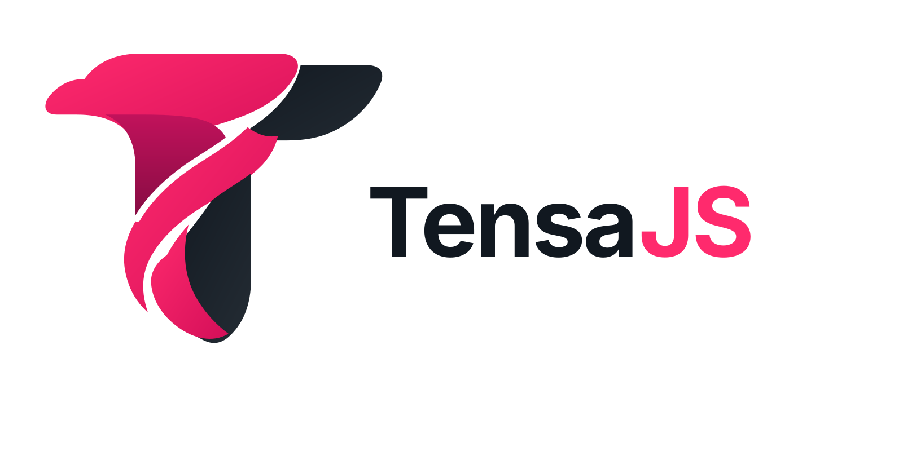

<p align="center">
  <picture>
    <source media="(prefers-color-scheme: dark)" srcset="Logo/TensaJS-logo-with-text-white.svg">
    <source media="(prefers-color-scheme: light)" srcset="Logo/TensaJS-logo-with-text.svg">
    
  </picture>
</p>

[](https://www.npmjs.com/package/tensajs)
[](https://bundlephobia.com/package/tensajs)
[](LICENSE)

TensaJS is a **JavaScript animation engine built to animate anything JavaScript can access**. Animate DOM elements, CSS properties, SVG, paths, plain JavaScript objects, values, and more using **JavaScript or JSON**. Build everything from simple tweens and timelines to complex physics-based motion, scroll-driven animations, text effects, interactive motion, and much more.

TensaJS combines a powerful animation system with a **built-in physics engine**. Tweens, timelines, and physics work together, so physical motion can be combined directly with traditional animation. Gravity, springs, collisions, soft bodies, velocity, and other dynamic behaviors sit alongside the rest of the animation.

TensaJS provides a broad system for creating and controlling motion, including **tweens, timelines, labels, nesting, staggering, scrubbing, easing, repetition, dragging, inertia, snapping, scroll-driven animation, SVG and path animation, FLIP-style layout animation, text effects, physics, dynamics, and much more**. All of these capabilities work together, giving you control over everything from individual property changes to complex interactive sequences.

[](https://tensajs.com)
[](https://docs.tensajs.com)
[](https://docs.tensajs.com/playground)

---

## Features

### Animate Anything

Animate DOM elements, CSS styles and transforms, SVG graphics, paths, plain JavaScript objects, and numeric values. TensaJS can also animate the values behind Canvas, WebGL, games, data visualizations, and custom rendering systems.

Target individual objects or entire groups using selectors, elements, collections, and arrays. Relative values, function-based values, keyframes, and staggered animation give you control across different targets and properties.

### JavaScript or JSON

Create animations in **JavaScript or JSON**, with support for the same tweens, timelines, and plugin-driven features. Use either format for individual animations, nested sequences, or larger motion systems.

JSON supports **timelines, labels, staggering, keyframes, easing, variables, defaults, callbacks, actions, and custom extensions**. Real-time schema validation helps catch errors as definitions are written. JSON definitions can also be compiled into native TensaJS animations that support playback, editing, nesting, and composition with other animations.


### Tweens & Timelines

TensaJS includes a full set of tools for creating, sequencing, and controlling animations. From a single property tween to an animation with multiple nested timelines, you have precise control over timing, playback, and how animations relate to one another.

- **Tweens and keyframes** - Animate properties, transforms, colors, and values with individual tweens or multi-step keyframes.
- **Timelines and labels** - Sequence, overlap, nest, and position animations using labels, timestamps, and relative offsets.
- **Staggering** - Animate groups with index-based, grid-based, distance-based, and custom stagger patterns.
- **Easing** - Choose from built-in easing functions, cubic Bézier curves, steps, custom easing, and registered easing definitions.
- **Playback and scrubbing** - Play, pause, reverse, restart, seek, scrub, and adjust playback speed.
- **Repetition and yoyo** - Build repeating sequences with repeat delays and alternating direction.
- **Dynamic values** - Use relative values, function-generated values, and continuously changing destinations.
- **Callbacks and controls** - Respond to animation events, place callbacks in timelines, and manage active animations.

TensaJS also provides **`createTracker()`** for smooth motion toward changing values, along with controls for overwrite behavior, time scaling, and frame-rate limits.

### Physics & Dynamics

TensaJS brings **physics directly into the animation system**, with a wide range of dynamic behaviors for interactive motion, physical effects, and animated simulations. Physics can be used alongside tweens, timelines, dragging, and other animation features.

Supported dynamics include:

- **Gravity** - Falling, acceleration, boundaries, and bouncing.
- **Springs** - Elastic movement, settling, and spring-based interactions.
- **Collisions** - Interactions between moving bodies and boundaries.
- **Soft bodies** - Flexible shapes that deform and respond to motion.
- **Orbits** - Circular and gravity-based orbital movement.
- **Pendulums** - Swinging motion with gravity and friction.
- **Magnetism** - Attraction toward elements or pointer positions.
- **Velocity and inertia** - Momentum-based movement and natural continuation after release.
- **Throw** - Velocity-driven throwing and momentum effects.
- **Slide** - Movement along inclined surfaces.
- **Explosions** - Radial impulses and outward motion.
- **Fluid drag** - Resistance-based movement and damping.
- **Followers** - Trailing elements and responsive follower motion.
- **Repulsion** - Force-based push-away interactions.
- **Swarms** - Group movement with separation, alignment, and cohesion.
- **Tethers** - Elastic connections and distance constraints.

These behaviors can be combined with standard animations to create everything from spring-based UI motion to physical interactions involving multiple moving objects.

### Scroll-Driven Animation

Create **scroll-driven tweens and timelines** with ScrollSync. Animate progress as the page scrolls, scrub through sequences, pin elements, and build motion around specific scroll positions or sections.

TensaJS supports **scroll triggers, scrub smoothing, pinning, custom scroll containers, start and end positions, direction and progress callbacks, and visual debug markers**. Scroll animations can also be combined with the same timeline, easing, and playback features available throughout the engine.

### SVG & Path Animation

TensaJS supports **SVG morphing, path following, and motion along curves and waypoints**.

**PathMorph** animates between SVG shapes, including paths with different point counts and drawing commands. It supports morphing complex shapes and combining path changes with other animated properties.

**PathTransition** supports movement along SVG paths and custom waypoints, with optional rotation to follow the direction of travel. Path animations support standard easing, timing, callbacks, and timeline sequencing.

### Layout Animation

Animate layout changes with **LayoutMorph**, TensaJS's FLIP-style layout animation system. Create smooth transitions when elements move, resize, reorder, or change position in a layout.

LayoutMorph supports **transform preservation, border-radius adjustments, staggered transitions, nested elements, element-to-element fitting, and out-of-flow transitions**. Layout animation can be used alongside regular tweens and timelines for more complex interface motion.

### Dragging, Inertia & Snapping

Build interactive dragging and throwing effects with **Interactable**, including support for both mouse and touch input.

TensaJS supports **axis locking, movement bounds, edge resistance, live snapping, grid snapping, snap points, velocity tracking, throw motion, and inertia after release**. Drag interactions can also be combined with springs, collisions, followers, and other dynamics.

### Responsive Animation

Create **breakpoint-specific animations** with CSS media query support. Define different motion for different screen sizes, including animations and interactions tailored to each layout.

The responsive system also supports automatic animation cleanup, reversion, and cleanup of breakpoint-specific event listeners or setup code as media queries change.

### Text Animation & Effects

TensaJS includes **TextSlicer** for animating individual characters, words, and lines. Split text can use tweens, timelines, staggering, and physics, with support for preserved links and formatting, accessible text, and markup restoration.

Built-in text effects include:

- Blur Reveal
- Glitch
- Jigsaw
- Scatter
- Typewriter
- Scramble Text
- Number Counters
- Clip-Path Reveals
- Elastic Snap
- 3D Flips
- Marquee
- Matrix Rain
- Neon Flicker
- Sine Wave
- Slot Machine
- Spotlight
- Squeeze & Pop
- Text Along a Path
- Text Swap
- Unfold
- Text Gradients
- Text Highlighting

Text effects support the same animation controls and can be combined with timelines, scrolling, interaction, and physics.

### Plugins & Extensibility

TensaJS includes a **plugin system** for animation, text, physics, scrolling, SVG, layout, and interaction features. Import the capabilities your project needs while keeping the core focused.

```js
import { blurReveal } from 'tensajs/plugins/Text';
import { applyGravity } from 'tensajs/plugins/Dynamics';
```

The engine also supports **custom property plugins, lifecycle hooks, custom easing, JSON actions and callbacks, custom tween parsers, and extension points for application-specific animation**.

Public APIs cover target resolution, property measurement, animation inspection, playback management, global defaults, time scaling, and frame-rate control.

---

## Install

Install TensaJS using npm:

```bash
npm install tensajs
```

The core and each plugin are imported separately:

```js
import { animate } from 'tensajs'; // Core
import { applyGravity } from 'tensajs/plugins/Dynamics'; // Plugin: applyGravity
import { ScrollSync } from 'tensajs/plugins/ScrollSync'; // Plugin: ScrollSync

animate('.box', {
  x: 200,
  duration: 1,
  scrollSync: { trigger: '.box', scrub: 1 } // Plugin: ScrollSync
});

applyGravity(...); // Plugin: applyGravity
```

Or use the CDN.

```html
<!-- Core -->
<script src="https://unpkg.com/tensajs/dist/cdn/tensajs.js"></script>

<!-- Plugin: applyGravity -->
<script src="https://unpkg.com/tensajs/dist/cdn/plugins/dynamics/applygravity.js"></script>

<!-- Plugin: ScrollSync -->
<script src="https://unpkg.com/tensajs/dist/cdn/plugins/scrollsync.js"></script>

<script>
  // Core
  Tensa.animate('.box', {
    x: 200,
    duration: 1,
    scrollSync: { trigger: '.box', scrub: 1 } // Plugin: ScrollSync
  });

  Tensa.Dynamics.applyGravity(...); // Plugin: applyGravity
</script>
```

TensaJS is **zero-dependency**, with a focused core and plugins for additional animation, physics, interaction, and visual effects.

---

## Documentation

[Website](https://tensajs.com) · [Documentation](https://docs.tensajs.com) · [Playground](https://docs.tensajs.com/playground)

## License

MIT
